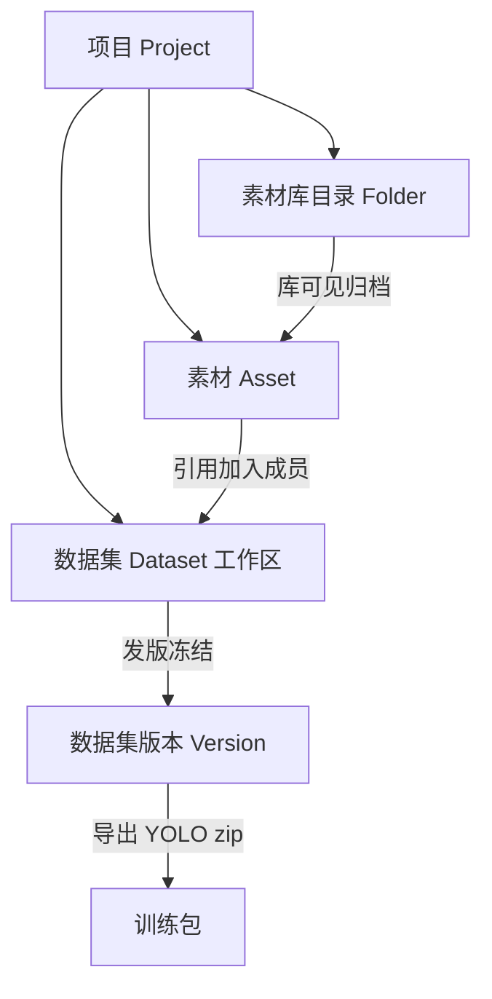

# 项目 · 素材库 · 素材 · 数据集 · 版本：概念与关系

面向使用者的领域说明。行为契约以 OpenSpec（`openspec/changes/bootstrap-labeltrace-platform/specs/`）为准；操作步骤见 [数据集从上传到发版](./数据集从上传到发版.md)。

---

## 一句话分层

| 层级 | 回答的问题 |
|------|------------|
| **项目** | 工作在哪个协作空间？谁能进？ |
| **素材库** | 原始媒体怎么归档、浏览、抽帧？ |
| **素材** | 某一段视频 / 一张图 / 一帧具体是什么？ |
| **数据集** | 当前要标哪些图、类别是什么？（可改的工作区） |
| **数据集版本** | 某次冻结下来、可导出训练的只读快照是什么？ |

核心关系：**素材可进多个数据集；标注按「数据集 × 素材」隔离；训练导出绑版本，不绑工作区实时状态。**

---

## 关系总览

```text
项目 (Project)
 ├── 成员与角色（owner / annotator / viewer）
 ├── 素材库：目录树 (Folder)
 │     └── 库可见素材：主要是 video、上传的 image
 ├── 非库可见素材：抽帧 frame、YOLO 导入 image …
 ├── 抽帧任务 → 产出 frame（挂在源视频下审查，不进目录平铺）
 └── 数据集 (Dataset) × N
       ├── 工作区成员（引用素材）+ 每成员一份标注
       └── 版本 (DatasetVersion) × N   ← 发版后只读；导出 YOLO 绑版本
```



---

## 项目（Project）

**项目**是租户边界：素材、目录、标签、数据集、版本、导入记录都属于同一个项目。标签是项目级扁平词表，挂在素材上，用于跨目录筛选（侧栏「标签」页可按标签浏览）。

- 跨项目互不可见。
- 权限按**项目成员角色**控制（负责人 / 标注员 / 只读），同一人可加入多个项目、角色彼此独立。
- 创建项目者自动成为该项目负责人。

没有「全局素材库」：换项目 = 换一套库与数据集。

---

## 素材库（Asset Library）

**素材库**不是单独一张表，而是项目里「给人归档浏览」的那一层：

- **目录树（Folder）**：可嵌套；用于整理**库可见**素材。
- **浏览**：目录内分「视频 / 上传图片」等；列表可分页。
- **不在目录里平铺的东西**：抽帧得到的 **frame**、YOLO **导入图**——它们仍是素材，但默认 `library_visible = false`，要在抽帧任务审查区或数据集成员里看到。

素材库回答的是：**原始交付物放哪、怎么找、怎么抽帧**；不直接等于「训练集」。

---

## 素材（Asset）

**素材**是一条媒体记录 + 二进制对象（按内容哈希存）。

| `media_kind` | 是什么 | 典型怎么来 | 能否直接画 YOLO 框 |
|--------------|--------|------------|-------------------|
| **video** | 源视频 | 上传到某目录 | **否**（先抽帧） |
| **image** | 静态图 | 库内上传，或 YOLO zip 导入 | **是** |
| **frame** | 视频抽出的一帧图 | 某次抽帧任务 | **是** |

补充字段（理解关系时常用）：

| 字段 | 含义 |
|------|------|
| `origin` | `upload` / `extract` / `import` |
| `library_visible` | 是否出现在素材库目录列表 |
| `folder_id` | 库可见时所属目录；导入图等可为空 |
| frame：`parent_video_id`、`frame_index`、`extract_job_id` | 追回「哪条视频、第几帧、哪次抽帧」 |
| import：`import_id` | 追回哪次 YOLO 导入 |

**引用保护：** 只要还被某个数据集成员或任一版本快照引用，就**禁止硬删**素材文件（返回冲突）。从数据集「移出」只删引用，不删库里的文件。

同一张图（同一内容哈希）在项目内通常只存一份二进制；多个数据集可以**引用**同一素材。

---

## 数据集（Dataset）

**数据集**是可编辑的**工作区**：选定一批素材当成员、启用项目里的类别、在上面标注。

- 属于某一个项目；一个项目可有多个数据集。
- **成员**是对素材的引用（`DatasetAsset`），可带划分字段；P0 发版时再按比例随机划分 train/val/test。
- **标注**键为 `(数据集, 素材)`：同一张图进两个数据集，框互不影响。
- **类别**属于项目词表（稳定 `id`、名称、颜色），在侧栏「YOLO类别」里维护，本身没有顺序。新建后默认出现在各数据集里；数据集页取消勾选只表示本集不用。框引用 `classId`。改名不改变 id。YOLO 的 `0,1,2…` 在**发版**时才生成并冻进版本：手建类别按加入该数据集的先后，导入包沿用包内顺序。已发版本保留发版时的名称和编号。仍被数据集选用、标注引用或已写入版本的类别不能删除。
- 成员来源可混合：抽帧 frame + 库上传 image + YOLO 导入 image。
- 详情里的 **来源摘要（memberSources）** 聚合「哪些抽帧任务 / 多少上传 / 哪次导入」，便于一眼看构成。

**数据集 ≠ 版本：** 工作区可以一直改；改完要固化给训练，再发版。

### 成员怎么进来

| 路径 | 说明 |
|------|------|
| 抽帧入集 | 视频抽帧 → 审查删帧 → 将剩余帧加入某数据集 |
| 库选图 | 图先上传到素材库目录 → 数据集页勾选加入 |
| YOLO 导入 | 上传 detect zip → **新建数据集**（或填入**空**数据集）→ 成员与标注一次写入；导入图不进素材库目录 |

导入**不会**自动创建版本；标注默认已是已提交，仍需你在版本页发版后才能按版本导出。

---

## 数据集版本（DatasetVersion）

**版本**是某次发版时对工作区的**不可变快照**：

- 冻结：成员列表、每张图的标注、类别、划分结果、来源摘要等。
- 发版后**不能改**该版本；要更新 = 改工作区 → 再发**新版本**。
- **导出 YOLO** 针对某一个版本，保证训练包与快照一致，不依赖之后工作区怎么改。
- 可「查看快照」（只读标注视图）；也可「应用到工作区」（合并回当前工作区，不修改该版本本身）。

父版本 / 变更摘要：新版相对上一版可看增删、改标等，便于审计。

---

## 对照：容易混淆的点

| 说法 | 实际含义 |
|------|----------|
| 「进库了」 | 素材 `library_visible`，出现在某目录列表（多为 video / 上传图） |
| 「进集了」 | 成为某数据集成员；可以标；frame/导入图常不进目录但仍进集 |
| 「标完了」 | 工作区里该成员标注已提交；**还不是版本** |
| 「发版了」 | 生成只读 `DatasetVersion`；此后导出应针对该版本 |
| 「删掉了」 | 移出数据集 ≠ 硬删素材；有版本引用时硬删会被拒绝 |

---

## 两条主路径（放在关系里看）

**视频优先（本产品主路径）**

```text
项目 → 素材库上传 video → 抽帧 → 审查 frame
     → 加入数据集工作区 → 标注 → 发版 → 按版本导出 YOLO
```

**已有 YOLO 包（辅路径）**

```text
项目 → 导入 zip → 新建（或空）数据集工作区（图+标已就位）
     →（可选再改标）→ 发版 → 按版本导出
```

两条路径最后都汇合到：**数据集工作区 → 版本 → 导出**。素材库负责「原始媒体从哪来」；数据集负责「这次训练候选集怎么标」；版本负责「交给训练的那一版是什么」。
